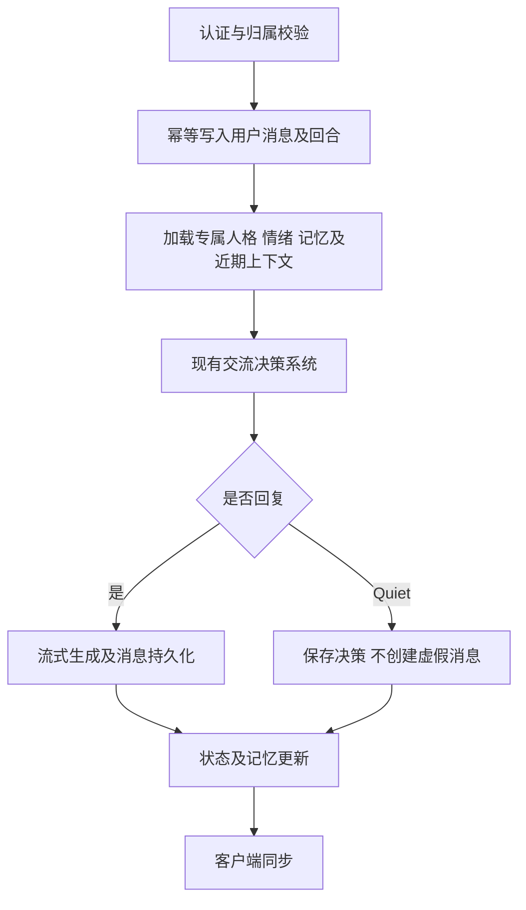

# AI 伴侣项目 · 用户体系与独立伴侣系统需求

**版本：V1.0 | 日期：2026-11-26 | 类型：增量开发需求与验收规范**

## 1. 背景与目标

将现有 AI 伴侣系统升级为支持多用户的应用。每个账户绑定一个独立伴侣和一个连续长期聊天会话，聊天记录、人格、记忆、情绪及主动沟通状态持久化。不同用户共享 FastAPI、模型接口和 PostgreSQL + pgvector 基础设施，但私人数据和运行状态必须隔离。移动端沿用已确定的登录、首页、聊天、设置四个页面。

本次属于增量升级，不重构现有核心认知系统。本文表名、字段和接口为目标契约；实施前必须检查实际代码、数据库迁移及现有约束，优先复用而非重复建设。

## 2. 产品规则

- 一个账户只能拥有一个伴侣实例；一个伴侣只属于一个账户。
- 首次注册初始化伴侣及长期会话；再次登录、换设备、重启服务不重新生成人格。
- 第一版不支持新建多个会话、切换伴侣或手动重置人格、记忆、情绪。
- 用户及伴侣原始聊天消息完整保存；正常使用中不允许通过认知编辑接口篡改历史。
- 保留账户注销及个人数据删除能力，不能以伴侣记忆不可编辑为由拒绝删除个人数据。
- 共享基础人格模板及模型配置；个体状态独立。独立实例指逻辑实例，不是每个用户独立部署模型或进程。

## 3. 账户与认证

第一版采用用户名或邮箱加密码；不引入短信、第三方登录。支持注册、登录、自动登录、退出登录、修改密码、多设备登录、个人资料和账户注销。邮箱如用于验证身份或找回密码，必须先完成验证；未实现邮件服务时不得声称支持自助找回。

密码使用 Argon2id 哈希；Access Token 短期有效，Refresh Token 轮换、可撤销，服务端保存刷新令牌哈希或等价安全会话记录。退出仅撤销当前设备会话，修改密码可撤销其他会话。全程 HTTPS；登录与注册限流，错误信息避免账户枚举。移动端使用系统安全存储，Web 使用适当的 HttpOnly/Secure/SameSite Cookie 策略并处理 CSRF。禁止记录密码、令牌及不必要的私人消息内容。

## 4. 初始化与绑定

1. 校验注册信息并创建唯一账户。
2. 创建专属伴侣，沿用现有随机人格生成及模板机制。
3. 初始化人格版本、记忆、情绪、关注主题、主动沟通状态。
4. 创建唯一长期会话，标记实例 ready。
5. 登录后加载该实例及历史记录。

数据库内创建操作使用事务；涉及外部模型的初始化不得持有长事务，采用 pending / ready / failed 状态及可重试任务。以 user_id 作为初始化幂等键，唯一约束防止并发重复创建；失败后恢复原实例而非另建伴侣。未 ready 时前端显示初始化状态并允许重试。

## 5. 数据库目标结构

所有主键建议 UUID，时间字段使用 TIMESTAMPTZ，统一 UTC 保存，展示按用户时区。以下为逻辑字段，实际名称兼容既有结构。

| 表 | 核心字段 | 约束 |
|---|---|---|
| users | id, username, email, password_hash, nickname, avatar_url, status, timezone, created_at, updated_at, last_login_at | 主键；规范化用户名唯一；非空邮箱唯一 |
| auth_sessions | id, user_id, refresh_token_hash, expires_at, revoked_at, created_at | 用户外键；令牌哈希唯一 |
| companions | id, user_id, name, persona_id, status, initialized_at, created_at, updated_at | user_id 非空、唯一、外键 |
| conversations | id, user_id, companion_id, status, last_message_at, next_sequence_no, created_at, updated_at | companion_id 唯一；归属一致性约束 |
| dialogue_turns（复用现有回合表） | id, conversation_id, trigger_type, trigger_message_id, status, decision, created_at, updated_at | 会话外键；用户触发消息唯一关联 |
| messages | id, conversation_id, client_message_id, turn_id, sequence_no, role, message_type, content, audio_url, audio_duration_ms, emotion_snapshot, metadata, status, is_proactive, created_at, updated_at | 会话外键；会话内顺序唯一；客户端幂等键唯一 |

### 5.1 消息字段规范

- role：user / companion；message_type：text / audio / image（预留，不强制本期新增媒体能力）。
- status：pending / completed / interrupted / failed（与现有状态枚举对齐）。
- client_message_id：用户消息必填，伴侣消息可空；重复请求返回既有结果，若同键不同内容则拒绝。
- turn_id：关联同一次交流决策与多条回复；主动消息亦应关联主动回合。
- sequence_no：会话内单调递增，服务端事务分配，不使用 MAX + 1 的无锁实现。
- 音频与图片存于私有文件或对象存储；数据库记录对象标识与元数据，读取时校验归属，不暴露永久公开链接。

### 5.2 约束与索引示意

```sql
-- 仅为目标约束示意，须经现有 schema 审查后生成迁移
ALTER TABLE companions ADD UNIQUE (user_id);
ALTER TABLE companions ADD UNIQUE (id, user_id);
ALTER TABLE conversations ADD UNIQUE (companion_id);
ALTER TABLE conversations ADD FOREIGN KEY (companion_id, user_id)
  REFERENCES companions (id, user_id);
ALTER TABLE messages ADD UNIQUE (conversation_id, sequence_no);
ALTER TABLE messages ADD UNIQUE (conversation_id, client_message_id);
```

对会话历史使用 (conversation_id, sequence_no) 索引进行游标分页；针对主动调度建立 next_review_at 等现有调度字段索引。若已存在等价索引不得重复创建。回合与消息的会话归属也应通过复合外键或等价约束保证。

## 6. 聊天记录持久化与交流流程



- 用户消息及待处理回合先提交数据库，再调用模型；数据库失败不得确认发送成功。
- 模型调用失败保留用户消息，回合标记失败，允许显式重试；重试不得重复写入用户消息。
- 一次决策可产生多条伴侣消息，分别保存，使用同一 turn_id。
- SSE 可展示临时增量；完成消息必须先持久化，再发出完成事件。无需逐 Token 落库；异常中断时记录回合状态，对已保存消息提供恢复机制。未持久化增量不视为正式历史。
- Quiet 仍保存决策及必要状态变化，但不写入虚假的伴侣回复。
- 语音生成与文本持久化解耦，文本完成后无需等待 TTS；音频完成后更新对应消息，失败可重试且不重复生成文本。
- 聊天记录是原始事实，记忆是筛选与归纳后的认知。禁止将全部历史无上限传入模型，沿用近期上下文和相关记忆召回策略。

## 7. 多用户隔离与并发

| 模块 | 隔离要求 |
|---|---|
| 人格 | 伴侣独立人格、演化版本 |
| 长期记忆 / pgvector | 查询、写入、更新均限定已认证用户所属伴侣 |
| 工作记忆 | 按伴侣或会话隔离 |
| 情绪 | 独立数值、变化记录及版本 |
| 交流决策 | 独立回合及决策日志 |
| 关注主题 | 独立兴趣、主题及评估状态 |
| 主动沟通 | 独立触发、冷却和调度状态 |
| 语音 | 独立配置及私有媒体访问 |
| 缓存与事件 | 缓存键、队列、SSE 订阅均包含归属标识 |

服务端从认证上下文解析 user_id，不信任客户端提交的 user_id 或 companion_id；每次资源访问验证归属。可使用 PostgreSQL RLS 作为纵深防御，但不能替代业务权限校验。后台任务明确携带归属信息。禁止使用全局可变对象保存某个用户的状态。

同一伴侣的交流处理使用跨进程可用的队列、租约或数据库锁进行串行化，避免多设备、主动消息并发覆盖状态；不同伴侣允许并行。不得持有长时间数据库事务等待 LLM。状态更新使用版本校验及幂等键，任务异常后可恢复。多设备断线重连以最后已确认事件或 sequence_no 补齐，客户端按 message_id 去重。

## 8. 主动沟通改造

统一调度器扫描符合 next_review_at 等条件的实例，避免每用户启动常驻任务。独立维护最近交流时间、最近主动沟通时间、下一次评估时间、情绪、沟通意愿、关注主题及冷却状态。沿用现有主动沟通决策规则，不因新增用户体系强制提高主动消息频率。

离线时生成的主动消息写入同一长期会话，上线后同步。调度任务使用唯一触发键、租约和过期恢复机制，避免重复执行。用户消息优先，主动任务执行前重新校验当前状态；采用预算、冷却与限流控制离线模型成本。注销或停用账户必须取消待执行任务。

## 9. API 契约（建议）

| 方法 | 路径 | 说明 |
|---|---|---|
| POST | /api/auth/register | 注册及初始化 |
| POST | /api/auth/login | 登录 |
| POST | /api/auth/refresh | 刷新令牌 |
| POST | /api/auth/logout | 撤销当前会话 |
| GET | /api/user/me | 当前账户 |
| PATCH | /api/user/me | 更新个人资料 |
| POST | /api/user/password | 修改密码 |
| DELETE | /api/user/me | 再认证后注销及删除申请 |
| GET | /api/companion/me | 专属伴侣及初始化状态 |
| GET | /api/companion/state | 当前状态 |
| GET | /api/chat/messages | 历史游标分页 |
| POST | /api/chat/messages | 幂等提交消息 |
| POST | /api/chat/turns/{id}/retry | 重试失败回合 |
| GET | /api/chat/stream | 认证后的 SSE 事件流 |

历史接口默认 30 条，支持 before_sequence 与 after_sequence，明确 has_more 和下一游标，客户端按升序展示。发送接口提交 client_message_id、message_type、content，返回已持久化消息及 turn_id。SSE 沿用已有协议，至少能够表达消息增量、持久化完成、Quiet、错误、状态更新和媒体就绪。事件包含稳定事件标识、关联回合及消息 ID；断线后通过数据库历史恢复。禁止在 SSE URL 中携带长期访问令牌。统一 401 未认证、403 或 404 越权、409 幂等冲突、429 限流等错误语义。

## 10. 移动端适配

- 登录页：注册、登录、自动登录、初始化进度与失败重试。
- 首页：加载当前账户的伴侣、时间及动态情绪形象，保持已确认的简洁布局。
- 聊天页：进入时加载最近消息，向上分页，实时收发、失败重试、断线恢复、主动消息同步；动态反馈保持在顶部头像。
- 设置页：账户资料、密码、退出及隐私管理；不提供人格、记忆和情绪手动修改入口。
- 退出或切换账户时关闭旧 SSE，取消旧请求，清除私人缓存及内存状态；防止迟到响应污染新账户。

## 11. 数据迁移及隐私生命周期

实施前盘点既有 users、companions、conversations、messages、回合和认知相关表，检查重复绑定、空归属、孤儿记录及不一致外键。备份并验证恢复能力。采用版本化迁移：先扩展字段，再对可确认归属的数据回填，校验后添加非空、唯一及外键约束。无法确认所有者的历史实验数据隔离保留，不自动分配给新用户。禁止直接清表或重建生产数据库。

账户删除需再次认证，撤销登录会话、停止调度，清理消息、人格、记忆、向量、媒体、缓存及任务数据；备份按明确的保留策略到期清理。具体保留期限和账户恢复窗口由上线隐私政策确定。开发和测试日志最小化私人数据。

## 12. 实施顺序

| 阶段 | 内容 | 优先级 |
|---|---|---|
| 1 | 审计现有代码、表结构、归属和接口差异 | P0 |
| 2 | 版本化迁移、认证及权限中间件 | P0 |
| 3 | 一对一绑定、初始化及恢复 | P0 |
| 4 | 消息及回合持久化、历史分页 | P0 |
| 5 | 全部认知模块归属隔离及并发控制 | P0 |
| 6 | SSE、断线恢复、多设备同步 | P0 |
| 7 | 主动沟通多实例调度 | P1 |
| 8 | 四个移动端页面对接 | P1 |
| 9 | 安全、迁移、性能及回归测试 | P0 |

P1 表示实现顺序靠后，不代表可以在保留相关功能的情况下跳过其隔离测试上线。

## 13. 验收清单

- [ ] 两个账户各生成独立伴侣，重复及并发初始化不产生多个实例。
- [ ] 初始化失败后可恢复，不遗留不可用账户。
- [ ] 登录、退出、令牌刷新、撤销和修改密码符合认证规则。
- [ ] 换设备、退出重登、后端重启后恢复同一伴侣及聊天记录。
- [ ] 用户 A 无法读取或修改用户 B 的消息、记忆、状态、媒体与 SSE。
- [ ] 向量检索、缓存、后台任务均通过跨账户隔离测试。
- [ ] 模型调用失败不丢失已确认用户消息；重复请求不会重复写入。
- [ ] 多条回复按正确顺序保存，Quiet 不产生虚假消息。
- [ ] SSE 中断、重连、服务重启后可以补齐已持久化消息。
- [ ] 同一账户多设备并发发消息，状态一致，无重复回合。
- [ ] 主动消息离线持久化，重复调度不产生重复消息。
- [ ] 账户切换清理缓存和旧订阅，迟到事件不串号。
- [ ] TTS 失败不影响文本记录，音频重试不产生重复文本。
- [ ] 账户注销后撤销令牌并完成个人数据清理流程。
- [ ] 旧数据迁移前后数量及归属可核对，备份可恢复。
- [ ] 原有人格、记忆、情绪、交流决策及主动沟通回归测试通过。
- [ ] 记录改造前后首字延迟、完整回复耗时、TTS 首包耗时及 P50/P95，认证与持久化不得引入未经评审的明显性能回退。

## 14. 给开发代理的执行约束

先输出代码与数据库现状审计、复用清单、差异清单、迁移方案及测试计划，再按上述顺序实施。优先复用现有服务与模型配置，不新建重复认知模块；不得改变现有主行为枚举和人格逻辑以迁就用户体系。数据库变更必须版本化，新增业务需提供自动化测试。交付时列出修改文件、迁移版本、接口变更、测试结果及未完成项；不得将未执行测试标为通过。

## 15. 决策与待核实项

本版默认采用一对一长期绑定、单一长期会话、账号密码认证、最近 30 条游标分页及共享服务架构。上述为本次建议的实现默认值，并非已验证的代码现状。当前未直接审查项目最新源代码及迁移文件，因此实际表名、接口、初始化机制和 SSE 协议仍须在阶段 1 对齐。生产数据保留期限、邮件验证服务、性能阈值须结合部署环境确认。不得为实现本文示意结构而破坏现有功能。
